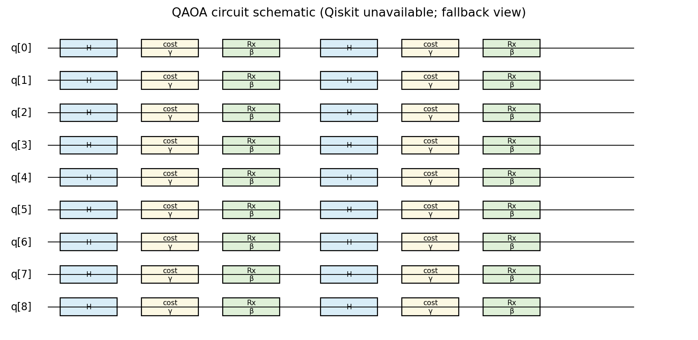
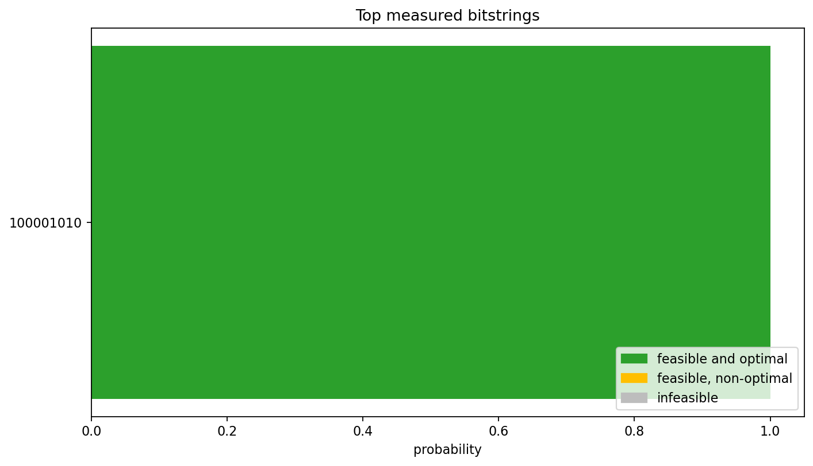
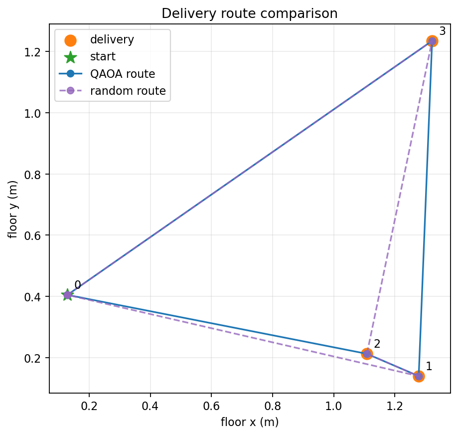
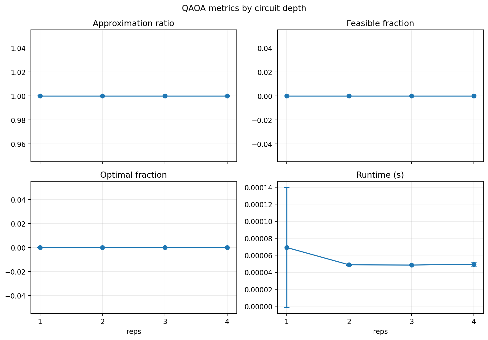

# Physical AI: QAOA Drone Route Planning

床に置いた配送先を認識し、出発地点を固定した4地点巡回問題をQAOAで計画するための最小構成です。量子計算は飛行前の経路計画だけに使用し、実機の飛行制御は別の安全なインターフェースで扱います。

## セットアップ

Python 3.10以上を用意し、依存関係をインストールします。

```bash
python -m pip install -r requirements.txt
python -m pip check
```

ローカル設定が必要になったら、`config/settings.example.yaml` を `config/settings.yaml` にコピーして編集してください。`settings.yaml`、`.env`、`results/` の実験ログは公開リポジトリに含めません。

## Runtime settings

`src/settings.py` が `config/settings.yaml` を一度だけ読み込み、カメラ、飛行、経路計画、ドローン通信の設定を検証して各実行経路へ渡します。設定値をコードへ直書きしないため、実際のIPアドレスや認証情報は `settings.yaml` にだけ記入してください。

```bash
cp config/settings.example.yaml config/settings.yaml
PYTHONPATH=. python src/main.py --check-settings
```

XIAO ESP32S3 Sense の SecHackカメラは、ファームウェアが提供する `/stream` を `camera.stream_url` に設定します。カメラ映像とArUcoマーカーを安全に確認するだけなら、次を使えます。これは離陸・移動指令を送らず、YOLO-Worldも実行しません。

```bash
PYTHONPATH=. python src/main.py --check-camera
```

`--check-camera` は最新フレームを複数回読み、古いMJPEGフレームを捨てた後、四隅のArUcoマーカーで床面校正を行います。カメラとPCが同じネットワークにいない場合、ストリームを開けずに終了します。

macOSでAndroid端末をUSBウェブカメラとして使う場合は、カメラ番号ではなく
`camera.avfoundation_device: "Android Webcam"` のようにAVFoundation上の表示名を設定してください。
この経路ではFFmpegを用いて指定名のデバイスだけから1フレームを取得するため、複数カメラ接続時に内蔵カメラへ切り替わる問題を避けられます。対応フレームレートは
`camera.avfoundation_framerate`（Android USB Webcamでは通常`30`）で指定します。

## QAOA route planner

`src/qaoa_route.py` は次を提供します。

- `build_qp`: 出発地点を位置0に固定した制約付き `QuadraticProgram` を構築
- `decode`: Qiskitのビット順（右端がqubit 0）を訪問順に変換
- `route_length`: 経路長を計算
- `brute_force`: 全探索による厳密解
- `solve_qaoa`: 距離を最大値で正規化し、ペナルティ付きQUBOをQAOAで解く

QAOAでは `StatevectorEstimator` でパラメータを最適化し、`StatevectorSampler` で測定します。測定結果は元の制約付き二次計画問題で実行可能性を判定した後、経路としてデコードします。実行可能なサンプルが一つもなければ全探索へ切り替え、結果に `used_fallback` を記録します。

```bash
PYTHONPATH=. python scripts/test_qaoa.py
```

出力には、近似比、実行可能解の割合、最適解の割合、量子ビット数、実行時間を含めます。

## Printable markers and perception

ArUcoマーカーと床面テクスチャは次のコマンドで生成できます。既定では
`results/printables/` に、A4・150 dpiのPNGを20枚（フィールド用4枚、機体用1枚、
オプティカルフロー用15枚）出力します。

```bash
PYTHONPATH=. python scripts/make_printables.py
```

`src/perception.py` の `FloorMapper` はID 0〜3のマーカー中心から画像を床座標へ
射影し、ID 10の機体マーカーにはカメラ高さと機体高度を使った視差補正を適用します。
`TargetDetector` は `ultralytics` のYOLO-Worldを遅延ロードします。モデル重みを取得する
テストは既定のpytest実行から除外しており、必要な場合だけ次で実行します。

動画フレームへの検出枠・床座標・予定経路の重畳は
`src.visualization.draw_mission_overlay` で行えます。

```bash
PYTHONPATH=. pytest -m yolo
```

## Mock mission

実機通信を行わずに一連の流れを確認するには、次を実行します。

```bash
PYTHONPATH=. python src/main.py --mock
```

既定では `results/run_log.json` に認識地点、QAOA経路・厳密解、評価指標、各地点の
目標・測定位置、視差補正前後の誤差、古典解への切替有無を保存します。`--armed` は
設定を検証してUDPリンクと実カメラアダプターを構築するところまでですが、実機ミッションは
現在も `NotImplementedError` で停止します。UDP接続、離陸、移動、着陸は行いません。

`--mock` を省略しても安全なモック動作が選ばれます。実カメラを `Mission` に接続する
`OpenCVCameraInput` は実機経路に用意されていますが、YOLO-Worldのモデル読み込みと
映像取得は `--check-camera` または実カメラの明示的な利用時だけ行われます。

### ROS 2 / RViz2 visual playback

Ubuntu 24.04 と ROS 2 Jazzy のRViz2で、モックミッションを3D表示できます。Ubuntu上で
次を実行すると、ミッションログを作成してから、予定経路・配送地点・ドローンの移動と
位置補正をRViz2で繰り返し再生します。

```bash
bash scripts/run_ros2_visual_sim.sh
```

UbuntuにQiskitが未導入の場合は、プロジェクト内の仮想環境へ追加できます。
仮想環境がある場合、起動スクリプトはそのPythonでQAOAを実行します。

```bash
python3 -m venv .venv-qiskit
.venv-qiskit/bin/python -m pip install -r requirements-qiskit.txt
bash scripts/run_ros2_visual_sim.sh
```

`results/ros2_simulation_log.json` に再生元のログを保存します。画面を閉じると再生も終了します。
この表示は既存の `MockDroneLink` の動きをRViz2で可視化するもので、Gazeboの物理・空力モデルは
使いません。実機への接続や飛行指令も行いません。
RViz2では青い機体、シアンの計画経路、橙色の実行軌跡、緑色の配送地点を表示します。
ログを再生成せず、既存ログだけを再表示する場合は `SKIP_MISSION=1 bash scripts/run_ros2_visual_sim.sh` を使います。

## StampFly UDP link

公開されているStampFly Ecosystemの現行API仕様に合わせ、`src/drone_link.py` に
`StampFlyUdpLink` を追加しました。

| 項目 | 採用仕様 |
|---|---|
| 通信方式 | Wi-Fi上のTello互換テキストAPI（UDP） |
| 接続先 | `config/settings.yaml` の `drone.host` のみから取得 |
| コマンドポート | UDP `8889` |
| 状態ポート | UDP `8890`（リンク設定として保持。テレメトリ読取は未実装） |
| コマンド開始 | `command`、成功応答 `ok` |
| 指令 | `takeoff`、`land`、`emergency`、`stop`、`go x y z speed` |
| `go`の単位 | `x,y,z` はcm、`speed`はcm/s（クラスの公開APIはm/m/s） |
| 移動範囲 | 合成移動量10〜300cm |
| 速度範囲 | 10〜100cm/s |

`takeoff [alt]` は別のWi-Fi CLI（`sf takeoff`）の構文であり、UDP 8889へ送っては
いけません。機体のSoftAP/STA設定、実際のホスト名/IP、POS_HOLD設定は現場の機体設定に合わせて
`settings.yaml`へ記入してください。`drone.go_*` と `drone.speed_*` の範囲もリンクへ
渡されます。実際の機体へ送信せずUDP受信だけ確認する場合は、
次のダミーサーバを使えます。

```bash
python scripts/dummy_udp_server.py --host localhost --port 8889 --reply-ok
```

出典: [Tello互換APIリファレンス](https://github.com/M5Fly-kanazawa/stampfly_ecosystem/blob/main/docs/architecture/tello-api-reference.md)、
[飛行コマンド一覧](https://github.com/M5Fly-kanazawa/stampfly_ecosystem/blob/main/docs/commands/flight-commands.md)。

## Benchmark results

ベンチマークは同じ20個のランダム配置に対して `reps=1..4` を比較し、平均±標準偏差を
`results/benchmark_qaoa.csv` に保存します。現在の実行環境ではQiskit未導入のため、20回
すべて厳密解へフォールバックしています。Qiskit導入後に再実行すると、実際のQAOA測定値へ
更新されます。

| reps | 近似比 | 実行可能解率 | 最適解率 | 実行時間[s] | フォールバック回数 |
|---:|---:|---:|---:|---:|---:|
| 1 | 1.000000 ± 0.000000 | 0.000000 ± 0.000000 | 0.000000 ± 0.000000 | 0.000069 ± 0.000070 | 20 |
| 2 | 1.000000 ± 0.000000 | 0.000000 ± 0.000000 | 0.000000 ± 0.000000 | 0.000049 ± 0.000001 | 20 |
| 3 | 1.000000 ± 0.000000 | 0.000000 ± 0.000000 | 0.000000 ± 0.000000 | 0.000048 ± 0.000000 | 20 |
| 4 | 1.000000 ± 0.000000 | 0.000000 ± 0.000000 | 0.000000 ± 0.000000 | 0.000049 ± 0.000002 | 20 |

ベンチマークと図は次で再生成できます。

```bash
python scripts/benchmark_qaoa.py
python scripts/make_figures.py
```

### Generated figures









## Tests

```bash
PYTHONPATH=. pytest -q
```

## 実機について

SecHackの特徴量リンク（UDP `5006`）は、physicalAIのStampFly飛行指令リンク（Tello互換UDP
`8889`）とは別用途です。physicalAIは特徴量パケットを送信しません。

実機経路は、`--armed` と端末での`yes`確認の両方が必要です。ただし現在は安全上、設定検証と
副作用のないオブジェクト構築後に `NotImplementedError` で停止します。`--armed`を通じた
飛行、カメラ認識、UDPコマンド送信はまだ有効化していません。緊急停止や`finally`の着陸処理は
`Mission`の実機経路に残していますが、実機飛行が可能だとは扱いません。
